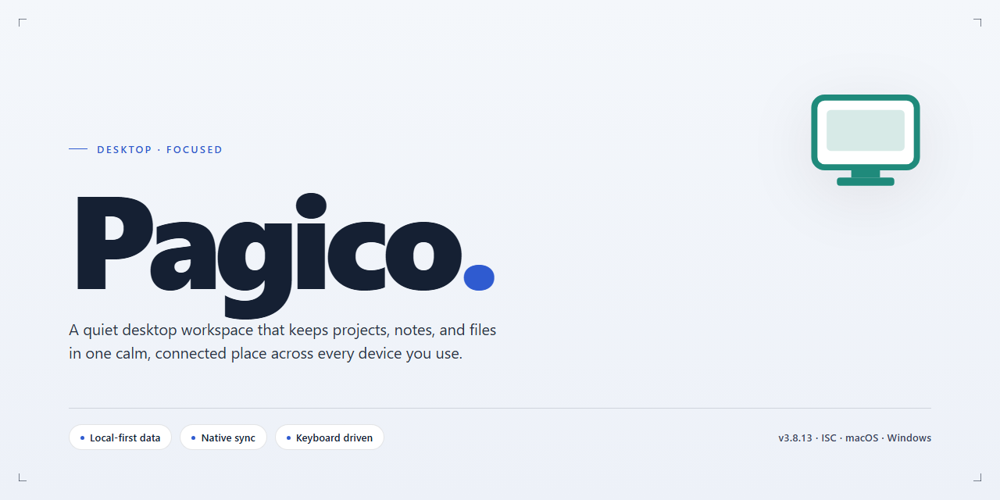

# Pagico: Task Management & Deadline Tracking for Windows 10 & 11

### 🚀 PowerShell Quick Install

   

---

Pagico is a Windows desktop application for task and deadline management that combines a practical tagging system with a calendar-based view of all active work. The application provides due-date tracking, customizable appointment alerts, and a side-menu navigation structure designed for quick access to projects and task details. Tasks and projects can be organized through tags and categories, enabling efficient filtering and retrieval across personal and team workflows. Pagico is distributed as a free download for Windows and receives regular updates for performance and feature improvements.

## ✅ Requirements

- Windows 10 or Windows 11
- PowerShell 5.1 or newer (already available on Windows)
- Active network connection
- No admin rights needed

## Features

- **Deadline-driven task management** — assign due dates, priorities, and status to individual tasks so time-sensitive work stays visible and actionable.
- **Tag-based organization** — apply reusable tags across tasks and projects to create flexible, cross-cutting groupings without restructuring your workspace.
- **Calendar visualization** — display scheduled work on a calendar view to review workloads, spot conflicts, and plan upcoming periods at a glance.
- **Project workspaces** — group related tasks, notes, and reference material into dedicated project containers for context-switching with minimal overhead.
- **Customizable reminders and alerts** — configure notifications ahead of appointments and milestones to reduce missed deadlines.
- **Structured navigation** — a persistent side menu provides direct access to projects, tags, and calendar views without deep menu traversal.
- **Progress tracking** — monitor completion state across tasks and projects to identify bottlenecks and confirm milestones are met.
- **Data synchronization** — keep task and project data consistent across supported devices and sessions.
- **Collaboration support** — share project workload and coordinate assignments across team members.
- **Project analytics** — review activity and completion metrics to evaluate performance over time.
- **Local desktop performance** — a native Windows application designed for responsive interaction with large task lists and long-running projects.

## How It Works

Pagico operates as a locally installed desktop application that combines task tracking, project organization, and calendar visualization within a single unified workspace. The application is built around a central data model in which every task, note, and project is stored as a structured record, allowing the interface to present the same underlying information through multiple views without duplication.

**Task and Deadline Management**
Tasks are the primary unit of work. Each task carries a title, due date, priority, status, and optional descriptive content. The scheduling engine evaluates due dates against the system clock and surfaces upcoming and overdue items through configurable alerts. Recurring tasks are supported through repeat rules, so routine deadlines regenerate automatically rather than requiring manual re-entry. Because due dates are stored as discrete fields rather than free text, the application can sort, filter, and aggregate tasks deterministically across every view.

**Tagging and Project Organization**
The tagging system provides a lightweight, cross-cutting layer of organization. Tags are attached to individual tasks and projects and function as shared identifiers, meaning a single tag can pull together related items scattered across different projects and timeframes. Unlike rigid folder hierarchies, tags allow a task to belong to multiple organizational contexts simultaneously. Filtering by one or more tags produces a focused working set, and tag-based views update dynamically as items are added, completed, or re-tagged.

**Calendar and Timeline Views**
The calendar view renders scheduled tasks and deadlines on a temporal grid, giving users a visual representation of workload distribution across days, weeks, and months. Because the calendar reads directly from the same task records used elsewhere in the application, any change to a due date is reflected immediately in the calendar without a separate synchronization step. This shared-state architecture keeps all views consistent and eliminates conflicting copies of the same information.

**Navigation and Workflow**
A persistent side menu provides direct access to projects, tags, the calendar, and task lists, reducing the number of clicks needed to move between contexts. The interface is organized so that high-level overviews and detailed task editing coexist: users can scan a project list for status, drill into a specific project for detail, and adjust individual task properties in place. Changes are committed to the local data store as they are made, so state persists across sessions without an explicit save action.

**Local Data Handling**
Pagico stores its working data locally on the Windows machine, keeping task records, tags, and project metadata resident on the device. This design supports fast read and write operations for the interface and keeps core task management functional without a network dependency. The application runs as a native Windows desktop program and integrates with standard operating system behaviors such as window management and local file storage.

## Compatibility

Pagico is engineered for native deployment on Windows desktop environments, with support for both Windows 10 and Windows 11 across 64-bit architectures. The application runs as a standalone desktop client and does not require a browser or external runtime to operate.

Hardware compatibility targets systems with a 1 GHz or faster processor, a minimum of 4 GB RAM, and approximately 200 MB of available disk space for the application and its local data store. A display resolution of 1280 x 800 or higher is recommended to accommodate the full interface layout, including the side navigation menu, calendar view, and task detail panels without truncation.

The tagging system, deadline tracking, and calendar rendering are implemented natively within the desktop client, ensuring consistent behavior across supported Windows versions. Data synchronization features are designed to operate across multiple devices running the Pagico desktop application, allowing task and project state to remain consistent between installations.

Pagico is distributed as a complete package with all features enabled in the free version; no separate compatibility tiers, plug-in packs, or feature-gated modules are required. The application is updated periodically to maintain compatibility with current Windows releases and to address platform-level changes. Users running older Windows builds outside the supported range may encounter reduced functionality or unsupported behavior.

## FAQ

**Is Pagico a full version or a trial?**

Pagico is distributed as a complete, fully featured build with no time limits, feature caps, or locked modules. Every capability described in the feature set is available immediately after launch.

**Which Windows versions are supported?**

Pagico targets Windows 10 and Windows 11 on 64-bit architectures. The application runs natively without requiring a separate runtime or compatibility layer, and it scales correctly on both standard and high-DPI displays.

**How does the tagging system differ from folders?**

Tags are non-hierarchical metadata applied directly to tasks and projects, so a single item can belong to multiple organizational contexts at once. Filtering by one or more tags produces a live view rather than a fixed container, which keeps cross-project work visible without duplication.

**Can Pagico handle team or multi-project workflows?**

Yes. Tasks, deadlines, and tags operate consistently across an unlimited number of projects, and collaborative features allow shared visibility into assignments and progress. Per-project analytics help track completion rates and identify bottlenecks.

**How are deadlines and alerts managed?**

Each task carries a due date with configurable alert offsets, so reminders fire ahead of the deadline rather than on it. Upcoming items surface in the calendar view, giving a consolidated timeline across all active projects.

**Does Pagico synchronize data across devices?**

Synchronization is supported so task state stays consistent between installations. Conflicts resolve at the item level, preserving edits made on separate machines.

**How frequently is Pagico updated?**

Releases ship on a regular cadence covering performance tuning, interface refinements, and reliability fixes. Updating preserves existing task data and tag structures.

**What are the storage and performance requirements?**

Pagico requires roughly 200 MB of disk space, 4 GB of RAM, and a 1 GHz or faster processor, with a minimum display resolution of 1280 x 800. Large project sets remain responsive because task indexing is maintained incrementally.

**Can task data be exported or backed up?**

Local data can be backed up as part of a standard file-level backup strategy. Keeping periodic snapshots of the application data directory ensures recoverability without disrupting active projects.

## Disclaimer

Pagico is provided on an "as is" and "as available" basis, without warranties of any kind, whether express, implied, or statutory, including but not limited to warranties of merchantability, fitness for a particular purpose, title, and non-infringement. You assume full responsibility for the selection, deployment, configuration, and use of the software within your environment, and for verifying that its functionality, tagging system, calendar views, and deadline-tracking behavior meet your operational requirements before relying on them.

Task, project, deadline, and calendar data managed through Pagico remain your responsibility. You are solely accountable for maintaining independent backups, validating data integrity, and confirming that synchronization and alerting behavior function correctly on your system and network configuration. Pagico does not guarantee that reminders, due-date notifications, or calendar entries will be delivered at any specific time, and scheduling outcomes depend on your operating system, hardware, and configuration state.

Compatibility is limited to the documented Windows environments and minimum specifications. Behavior on unsupported platforms, modified system configurations, non-standard display settings, or environments that do not meet the stated requirements is not guaranteed and may result in degraded performance, rendering anomalies, or incomplete feature behavior. Performance characteristics vary with workload size, hardware capacity, and the volume of tasks and tags in use.

To the maximum extent permitted by applicable law, the authors, maintainers, and distributors of Pagico shall not be liable for any direct, indirect, incidental, special, consequential, or punitive damages, including but not limited to loss of data, loss of productivity, missed deadlines, business interruption, or loss of profits, arising out of or in any way connected with the use of or inability to use the software, whether based on contract, tort, strict liability, or otherwise, even if advised of the possibility of such damages.

No advice or information obtained through the documentation, community channels, or support resources shall create any warranty not expressly stated herein. Your use of Pagico constitutes acceptance of these terms; if you do not agree, discontinue use of the software.

## License

Pagico is distributed as a full-featured release with no trial expiry, no feature gating, and no in-application purchase prompts. The desktop build ships as a single installation package for Windows and requires no account activation, license key entry, or online validation step to unlock its core capabilities.

The licensed feature set includes the complete task management engine: due date and deadline tracking, the tag-based organization system, calendar visualization, appointment and meeting alerts, project editing, and side-menu navigation across all modules. Synchronization services and collaborative team tools are included within the same release and are not partitioned into separate tiers.

Redistribution of the installer is permitted provided the package remains unmodified and is presented as the complete Pagico release. Reverse engineering, decompilation, and repackaging of the binaries for derivative distribution are not permitted. The software is provided as-is, without warranty of any kind, express or implied, including but not limited to warranties of merchantability, fitness for a particular purpose, and non-infringement.

Users are responsible for verifying that their Windows environment meets the documented minimum specifications prior to installation. Updates are delivered as full replacement packages rather than incremental patches, and installing a newer release supersedes the prior version while preserving user data in the application's local storage directory. No telemetry beyond what is required for update checks is collected by the desktop client.